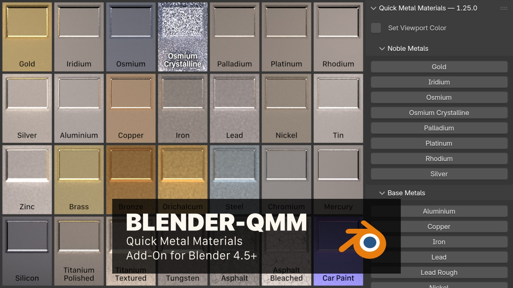

# Blender QMM (Quick Metal Materials)

Blender extension for adding metal materials to your scene.

## Requirements

- Blender 4.5 LTS or later

## Installation

1. Download the latest ZIP from **Releases**. Do not extract it.
2. In Blender, open `Edit > Preferences > Add-ons`.
3. Open the menu and choose **Install from Disk…**.
4. Select the downloaded ZIP.
5. Enable **QMM (Quick Metal Materials)** if necessary.

The **Quick Metal Materials** panel appears in the **MAT** tab of the 3D Viewport sidebar.

## Usage

- Select an object in your view, and click a button to assign that material to it

## Swatches
For swatches and notes, [refer to the Wiki](https://github.com/don1138/blender-qmm/wiki)

## Online Presence

- [Artstation](https://www.artstation.com/marketplace/p/p88LG/blender-qmm-quick-metal-materials)
- [Blender Artists Thread](https://blenderartists.org/t/blender-qmm-quick-metal-materials-free-addon/1290433)
- [Gumroad](https://gumroad.com/l/blender-qmm)

## Mentions

- [Blender Addons](https://blender-addons.org/quick-metal-materials/)
- [Model Happy](https://modelinghappy.com/archives/42400)
- [Python Awesome](https://pythonawesome.com/blender-add-on-to-add-metal-materials-to-your-scene/)
- [Steven Scott](https://www.youtube.com/watch?v=XWM4W_Cnies)

  

  
  
   
  

